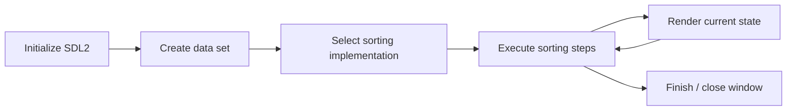

<div align="center">

# Sorting Algorithms Visualizer

**A C++ and SDL2 project for observing classic sorting algorithms in action.**


</div>

## Contents

- [Overview](#overview)
- [Algorithms](#algorithms)
- [Execution flow](#execution-flow)
- [Requirements](#requirements)
- [Build and run](#build-and-run)
- [Repository structure](#repository-structure)
- [Implementation notes](#implementation-notes)
- [License](#license)

## Overview

This project explores sorting algorithms through a graphical C++ application built with SDL2. Instead of looking only at the final sorted array, the visualizer is intended to make the sorting process observable.

It is a learning project focused on algorithm behavior, C++ and real-time graphical rendering.

## Algorithms

| Source file | Algorithm |
|---|---|
| [insertion_sort.cpp](insertion_sort.cpp) | Insertion Sort |
| [quick_sort.cpp](quick_sort.cpp) | Quick Sort |
| [selection_sort.cpp](selection_sort.cpp) | Selection Sort |

## Execution flow



The diagram represents the intended visualization flow; exact rendering and interaction behavior depend on the selected source implementation.

## Requirements

- C++ compiler
- SDL2
- SDL2_image
- Linux environment compatible with the supplied shell script

## Build and run

The included [comp.sh](comp.sh) script is configured to compile and execute `quick_sort.cpp`. The insertion-sort and selection-sort compiler commands are present as comments in the script.

```bash
chmod +x comp.sh
./comp.sh
```

The script creates a temporary executable named `model`, runs it, and removes it afterward. If you want to retain the binary or select another algorithm, edit the build command locally or compile the corresponding source file manually.

## Repository structure

```text
AlgoritimosOrdenacao/
├── insertion_sort.cpp
├── quick_sort.cpp
├── selection_sort.cpp
├── comp.sh
└── README.md
```

The repository also includes SDL2 shared-library files. Their compatibility with your operating system and architecture is not guaranteed.

## Implementation notes

This repository is a visual learning tool, not a benchmark suite. Meaningful performance comparisons require identical input data, compiler settings, and measurement methodology.

## License

No `LICENSE` file is currently included. Unless a license is added, reuse and redistribution permissions are not granted by this repository.
